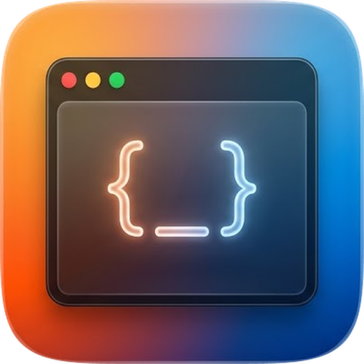
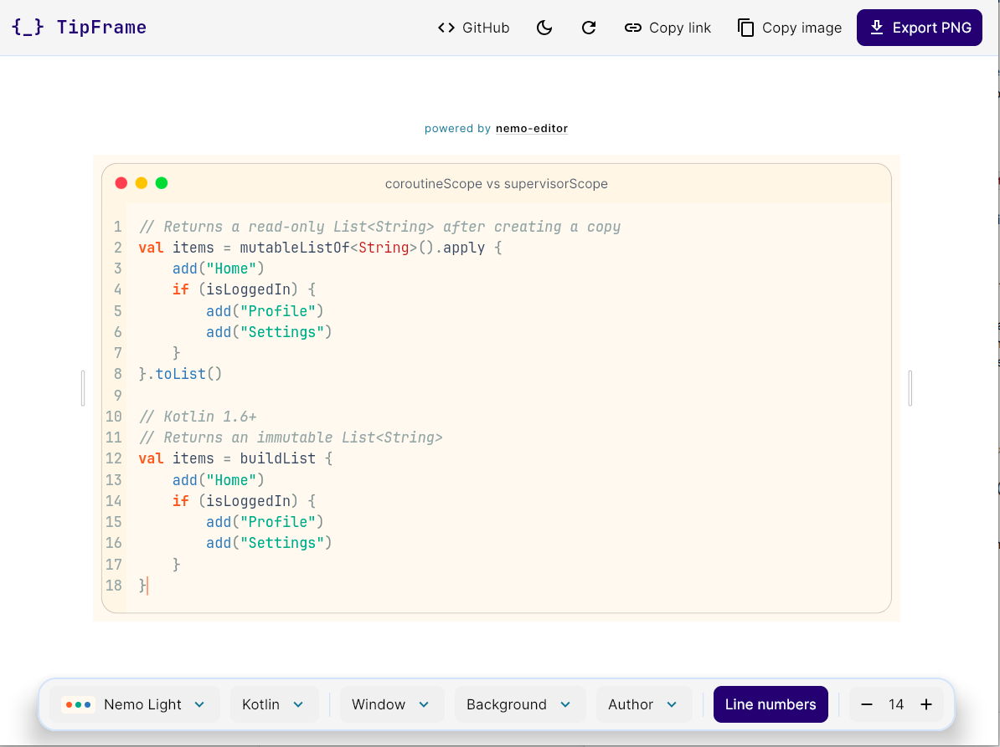
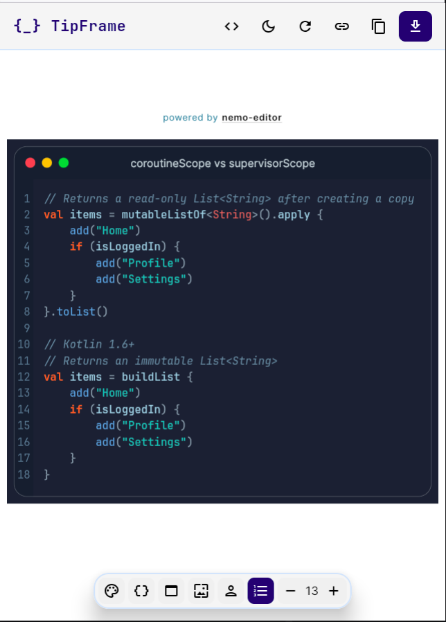

<div align="center">



# `{_}` TipFrame

### Turn your code into a beautiful image

Paste a snippet, pick a theme, a window and a background, then export a PNG or
share a link. For code tips, posts,and docs.

[](#web)
[](https://kotlinlang.org/docs/multiplatform.html)
[](https://www.jetbrains.com/compose-multiplatform/)
[](LICENSE)

**[Open the web version](https://ma7moud3ly.github.io/tip-frame)**


&nbsp;


</div>

## What it does

**Window frames**: wrap the code in a macOS, Windows, terminal, browser or
phone window, or no window at all. The title is edited right in the title bar.

**Code themes**: 19 themes for the code frame, picked from a grid of previews.

**Backgrounds**: solid, gradient, mesh, dots, grid or lines, in colors taken
from the code theme, with adjustable padding and an optional shadow. With no
background, the padding takes the window's own color.

**Highlighted lines**: click a line number to highlight its line, and click it
again to clear it.

**Author badge**: sign the image with your name and handle, next to your
initials or a LinkedIn, X, Instagram or Facebook mark.

**Any width**: drag the edges of the frame to make it wider or narrower. The
height follows the code.

**Export and share**: save a sharp PNG at twice the size you see, copy the
image to the clipboard, or copy a link that reopens the same frame. The web
app keeps your last frame for the next visit.

**Dark and light**: the app itself comes in a dark and a light theme, apart
from the theme of the code.

**Phones and wide screens**: the page adapts, with an icon dock on a narrow
screen and the frame fitted to its width.

---

## Web

**[Open the web version](https://ma7moud3ly.github.io/tip-frame)**. Everything
runs in the browser: the code never leaves your device, and the whole frame is
stored in the page address, so a link is all it takes to share it.

> The web app is compiled to WebAssembly and needs a recent version of Chrome,
> Edge, Firefox or Safari.

### Build

```bash
# development server, opens the browser
./kotlin run -m webApp

# production build
./kotlin build -m webApp -v release
```

The production build lands in `build/tasks/_webApp_buildWasmJsAppWasmJsRelease/`,
ready to host on any static server.

---

## Development

The same app also runs as a desktop window, which reloads the UI as the code
changes. It is there for working on the app; releases are web only.

```bash
# desktop window with hot reload
./kotlin run -m desktopApp
```

---

## Built with

- [Kotlin Multiplatform](https://kotlinlang.org/docs/multiplatform.html) and
  [Compose Multiplatform](https://www.jetbrains.com/compose-multiplatform/): the
  app, compiled to WebAssembly
- [nemo-editor](https://github.com/Ma7moud3ly/nemo-editor): the Compose code
  editor, its themes and its line highlights
- [Kotlin Toolchain](https://kotlin-toolchain.org): builds and runs the project
- [Multiplatform Settings](https://github.com/russhwolf/multiplatform-settings):
  remembers the last frame and the app theme
- [JetBrains Mono](https://www.jetbrains.com/lp/mono/),
  [Inter](https://rsms.me/inter/) and
  [Tourney](https://fonts.google.com/specimen/Tourney): the fonts of the code,
  of the app and of the watermark
- [Material Icons](https://fonts.google.com/icons): icons

## License

TipFrame is released under the [MIT License](LICENSE).

The bundled fonts keep their own license, the SIL Open Font License:
[JetBrains Mono](licenses/JetBrainsMono-OFL.txt),
[Inter](licenses/Inter-OFL.txt) and [Tourney](licenses/Tourney-OFL.txt).
